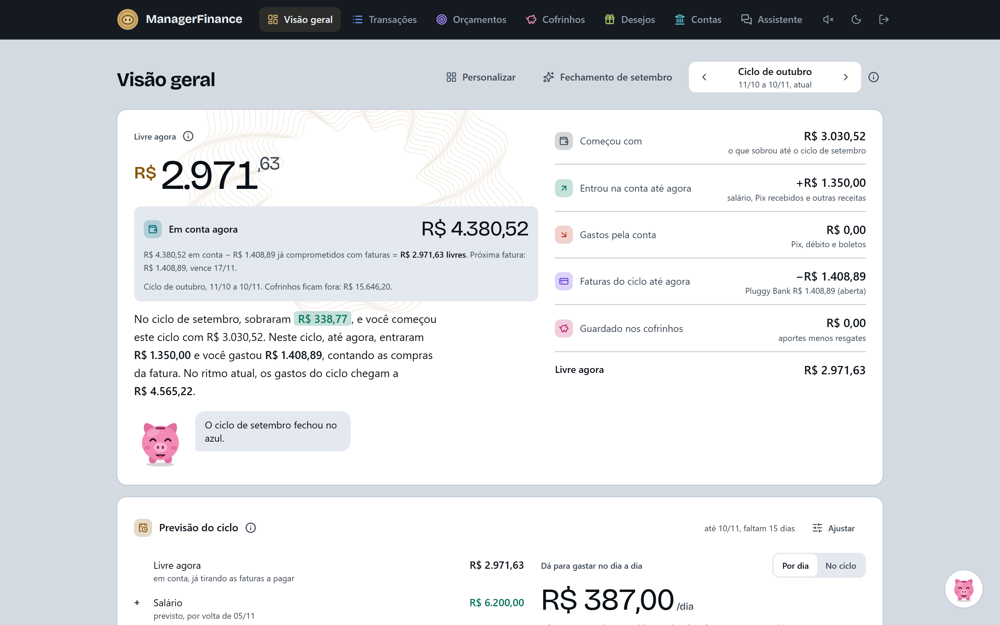
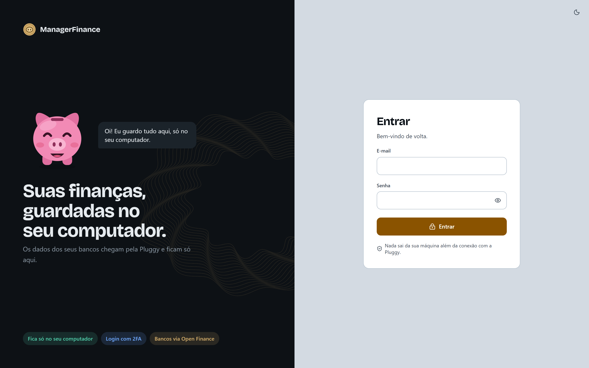
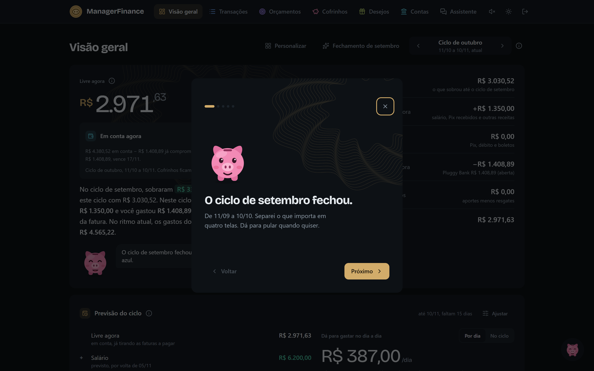
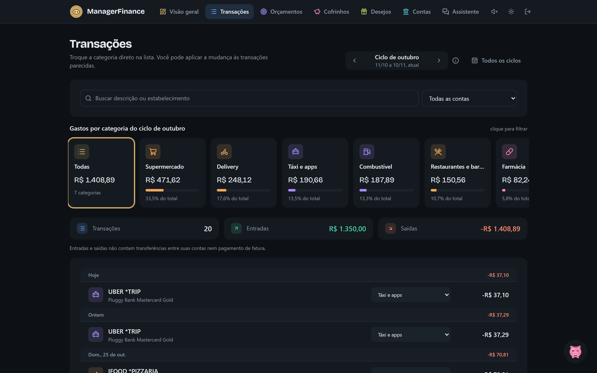
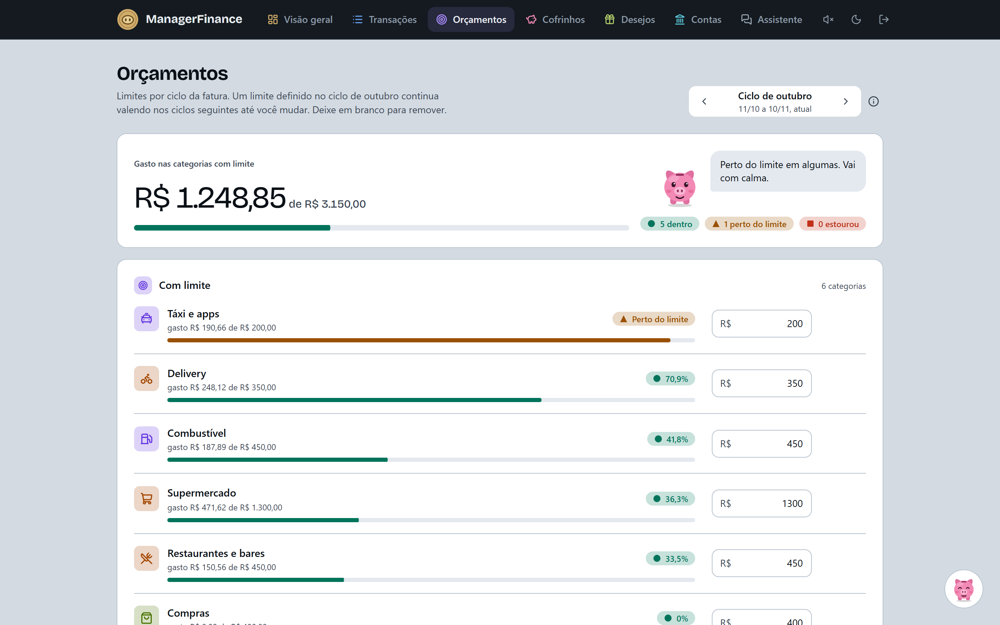
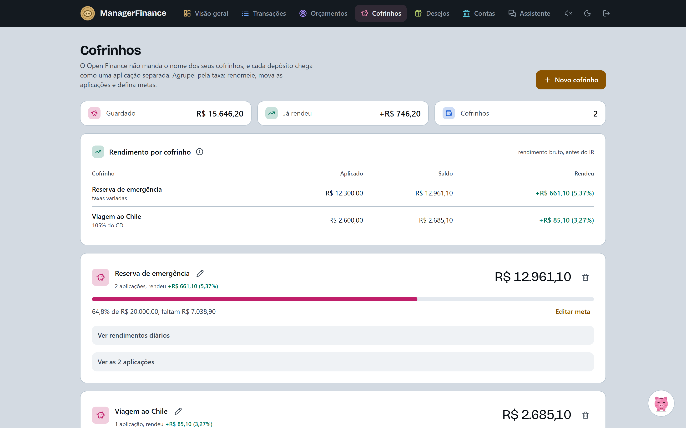
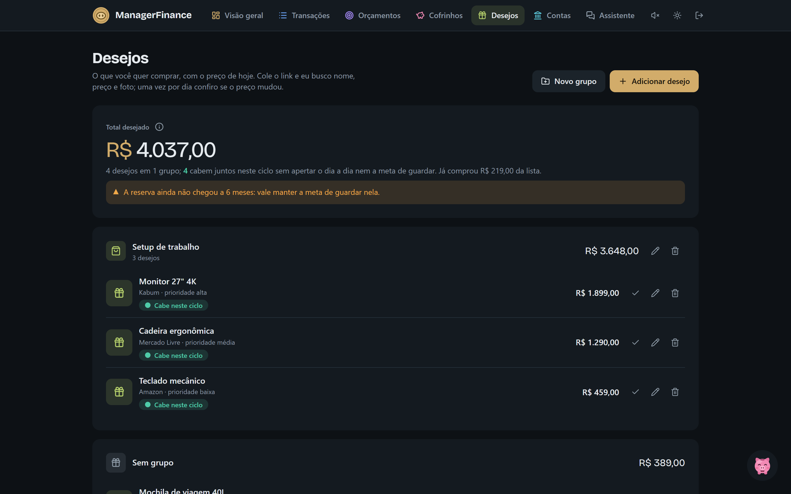
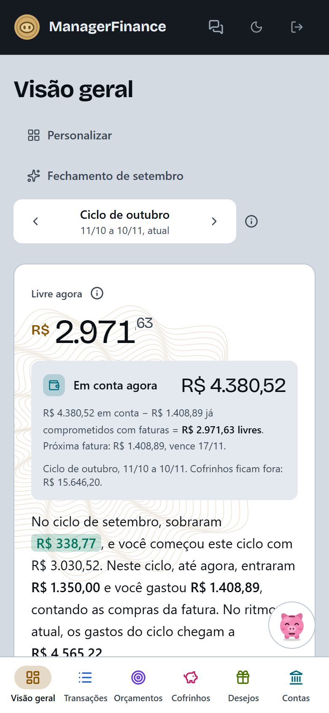

<div align="center">


# Finora

**Suas finanças, guardadas no seu computador.**

Sistema pessoal de finanças que puxa as transações dos seus bancos via Open Finance,
categoriza os gastos e mostra, ciclo a ciclo, quanto dá para gastar sem apertar.


<p>
  <a href="https://github.com/daniellealpimenta/Finora/releases/latest/download/Finora-macOS.dmg"></a>
  &nbsp;
  <a href="https://github.com/daniellealpimenta/Finora/releases/latest/download/Finora-Windows-Setup.exe"></a>
</p>

<sub>Baixou, abriu, pronto: sem clonar nada nem abrir terminal. <a href="https://github.com/daniellealpimenta/Finora/releases">Todas as versões</a></sub>

</div>

<picture>
  <source media="(prefers-color-scheme: dark)" srcset="docs/screenshots/dashboard-dark.png" />
  
</picture>

> [!NOTE]
> Todos os prints usam **dados fictícios** (banco de testes "Pluggy Bank"). Nenhum dado real
> aparece neste repositório.

---

## 🔒 Roda 100% local

- 🏠 A API escuta só em `127.0.0.1`; nada é exposto à rede.
- 🏦 Seus dados bancários passam pela [Pluggy](https://pluggy.ai) (necessário para o Open
  Finance), mas a sua cópia fica só na sua máquina, num arquivo SQLite.
- 🤖 O assistente usa um modelo rodando no seu computador (Ollama). Nenhuma transação vai para
  API de terceiros.

## ✨ O que ele faz

| | |
|---|---|
| 🔄 **Sync automático** | Open Finance via Pluggy / Meu Pluggy, a cada 6 h, com deduplicação |
| 🗓️ **Ciclo da fatura** | Tudo organizado pelo período entre fechamentos do cartão, não pelo mês do calendário |
| 💸 **Livre agora** | Saldo em conta menos o que já está comprometido com faturas |
| 📈 **Previsão do ciclo** | Quanto dá para gastar por dia até o fim do ciclo, já guardando a meta |
| 🏷️ **Categorização** | Regras automáticas + correções suas que valem para as transações parecidas |
| 🎯 **Orçamentos** | Limite por categoria, com aviso quando chega perto |
| 🐷 **Cofrinhos** | Agrupa as aplicações (caixinhas, CDBs), acompanha meta e rendimento diário |
| 🎁 **Desejos** | Lista de compras com preço monitorado e "cabe neste ciclo?" |
| 💳 **Cartões e faturas** | Faturas abertas e fechadas, parcelas futuras e limite comprometido |
| ❤️ **Saúde financeira** | Score com taxa de poupança, reserva de emergência e gastos fixos |
| 💬 **Assistente** | Chat com o Pila sobre os seus números, com LLM local |
| 📄 **Importar OFX** | Para bancos sem Open Finance; reimportar não duplica |

## 📸 Telas

<table>
  <tr>
    <td width="50%"><br/><sub><b>Login</b>: senha + 2FA opcional</sub></td>
    <td width="50%"><br/><sub><b>Fechamento do ciclo</b>: o resumo do mês que passou</sub></td>
  </tr>
  <tr>
    <td><br/><sub><b>Transações</b>: gastos por categoria, troca de categoria direto na lista</sub></td>
    <td><br/><sub><b>Orçamentos</b>: limite por categoria no ciclo</sub></td>
  </tr>
  <tr>
    <td><br/><sub><b>Cofrinhos</b>: metas e rendimento das aplicações</sub></td>
    <td><br/><sub><b>Desejos</b>: o que cabe neste ciclo sem apertar</sub></td>
  </tr>
</table>

<p align="center">
  <br/>
  <sub>📱 Também funciona no celular</sub>
</p>

## 🐷 Conheça o Pila

O Pila é o porquinho mascote do app. Ele não aparece em todo card, só quando tem algo a
dizer: no login, num estado vazio, quando o ciclo fecha no azul, numa sincronização ou num
erro. Tem seis humores (`happy`, `neutral`, `worried`, `sleep`, `shy`, `celebrate`), pisca de
vez em quando e segue o ponteiro com os olhos. É também a cara do assistente.

Feito em SVG puro e animado com GSAP: veja [`frontend/src/components/pila.tsx`](frontend/src/components/pila.tsx).
Com "reduzir movimento" ligado no sistema, ele fica parado.

## 🧱 Estrutura

```
backend/    FastAPI + SQLAlchemy + Alembic + SQLite (Python 3.12, uv)
frontend/   Next.js 15 + React 19 + Tailwind 4 + GSAP
docs/       notas de arquitetura (assistente local) e prints
scripts/    build do programa para Windows (.exe) e macOS (.app/.dmg)
```

## 🚀 Primeiros passos

### 1. Configuração

```bash
cp .env.example .env
# gere JWT_SECRET e FIELD_ENCRYPTION_KEY (comandos no próprio .env.example)
```

> [!CAUTION]
> O `.env` guarda o segredo da Pluggy e a chave de criptografia. Ele já está no
> `.gitignore`: **nunca o commite**.

### 2. Validar a Pluggy

1. Crie uma conta em https://dashboard.pluggy.ai, crie uma aplicação e copie
   `CLIENT_ID`/`CLIENT_SECRET` para o `.env`.
2. Conecte seus bancos no [Meu Pluggy](https://meu.pluggy.ai).
3. No dashboard da Pluggy, use o Connect/Demo da sua aplicação para conectar o conector
   **MeuPluggy** e anote o `itemId` gerado.
4. Rode:

```bash
cd backend
uv sync
uv run python -m scripts.pluggy_check <item_id> --days 30
```

### 3. Rodar o sistema

Não precisa de Docker nem de servidor de banco: o banco é um arquivo SQLite em
`%LOCALAPPDATA%\ManagerFinance\managerfinance.db`, fora do OneDrive (no macOS:
`~/Library/Application Support/ManagerFinance/`). A pasta mantém o nome de antes do Finora.

Primeira vez (dentro de `backend/`):

```bash
uv run alembic upgrade head                               # cria/atualiza o banco
uv run python -m scripts.create_user voce@exemplo.com     # cria seu usuário
```

Depois, em dois terminais:

```bash
cd backend && uv run uvicorn app.main:app --reload        # API: http://localhost:8000/docs
cd frontend && npm install && npm run dev                 # app: http://localhost:3000
```

💾 **Backup:** com o backend parado, copie o arquivo `managerfinance.db`.

🔁 **Depois de atualizar o código:** sempre que houver migração nova
(`backend/migrations/versions`), rode `uv run alembic upgrade head` dentro de `backend/`.

### 🖥️ Programa para Windows e macOS

O Finora também vira um programa de verdade, com janela própria: nada de terminal nem de
navegador. É o mesmo código do modo web, só empacotado. Os dois usam o mesmo banco, então
use um de cada vez.

#### 📥 Instalando (para quem vai usar)

Não precisa saber programar nem clonar o projeto. É só baixar:

<p align="center">
  <a href="https://github.com/daniellealpimenta/Finora/releases/latest/download/Finora-macOS.dmg"></a>
  &nbsp;
  <a href="https://github.com/daniellealpimenta/Finora/releases/latest/download/Finora-Windows-Setup.exe"></a>
</p>

**🍎 No Mac** (com chip Apple, M1 em diante)

1. Abra o `Finora-macOS.dmg`.
2. Arraste o Finora para a pasta **Aplicativos**.
3. Na primeira vez, o Mac pode avisar que não conhece o app. Tudo bem: vá em **Ajustes do
   Sistema → Privacidade e Segurança** e clique em **Abrir mesmo assim**. Só acontece uma vez.
4. Pronto. Ele fica no Launchpad e no Spotlight; arraste para o Dock se quiser ele sempre à mão.

**🪟 No Windows** (64 bits)

1. Execute o `Finora-Windows-Setup.exe`.
2. Se o Windows mostrar "O Windows protegeu o computador", clique em **Mais informações →
   Executar assim mesmo**. Só na primeira vez.
3. Siga o instalador (não pede senha de administrador). O Finora entra no Menu Iniciar e,
   se você quiser, ganha um atalho na Área de Trabalho.
4. Para fixar: Menu Iniciar → Finora → botão direito → **Fixar na barra de tarefas**.

Para desinstalar: **Configurações → Aplicativos → Finora**. Os seus dados ficam guardados, caso
você instale de novo.

#### 👋 A primeira abertura

Na primeira vez, o Finora se configura sozinho e o Pila guia o resto:

1. **A configuração é criada para você.** O programa cria o arquivo `.env` (no formato do
   `.env.example`) e já gera os dois códigos de segurança: `JWT_SECRET` e
   `FIELD_ENCRYPTION_KEY`. Ninguém precisa abrir um terminal.
2. **Você cria o seu acesso.** E-mail, um nome de usuário (se quiser) e uma senha de pelo
   menos 12 caracteres.
3. **Você conecta a Pluggy.** Crie uma conta grátis em
   [dashboard.pluggy.ai](https://dashboard.pluggy.ai), crie uma aplicação e cole o
   **Client ID** e o **Client Secret**. O Finora confere com a Pluggy antes de salvar. Sem
   pressa: dá para pular e fazer depois em **Perfil → Chaves**.
4. **Tudo pronto.** É só ir em **Contas → Conectar banco**.

Da segunda vez em diante, o Finora abre direto no login, **já com o seu último e-mail ou
usuário preenchido**: é só digitar a senha. Quer entrar com outra conta? Clique em
"Entrar com outra conta".

<details>
<summary>Detalhes para os curiosos</summary>

- A tela de boas-vindas só aparece enquanto não existe nenhum usuário no banco. Depois disso,
  ninguém cria uma conta nova por ela.
- O programa nunca troca um código que já existe no `.env` (trocar a chave de criptografia
  desfaria o 2FA).
- Pelo app só dá para mudar as chaves da Pluggy, e sempre pedindo a sua senha. Os outros
  códigos ficam só no arquivo.
- O último login fica guardado no próprio banco (a janela do programa não guarda nada do
  navegador). Se você trocar o e-mail ou o usuário no Perfil, ele deixa de sugerir o antigo.

</details>

#### 🔄 Atualizações

Quando sai uma versão nova, o próprio Finora avisa: aparece uma faixa no topo, com o Pila,
dizendo "Saiu a versão X do Finora!".

1. Clique em **Baixar**. O navegador baixa o instalador certo para o seu sistema.
2. Instale por cima:
   - 🍎 **Mac:** feche o Finora, abra o `.dmg` e arraste o Finora para Aplicativos,
     escolhendo **Substituir**.
   - 🪟 **Windows:** abra o instalador. Ele mesmo fecha o Finora e instala por cima.
3. Abra o Finora de novo. Pronto!

Seus dados, o acesso e as chaves da Pluggy continuam do jeito que estavam: eles ficam numa
pasta separada do programa. Se a versão nova mudar algo no banco, o Finora ajusta sozinho e
guarda antes uma cópia (`managerfinance.db.bak`).

<details>
<summary>Detalhes para os curiosos</summary>

- O Finora pergunta ao GitHub qual é a última versão, no máximo a cada 6 horas. É só essa
  pergunta: nenhum dado seu sai do computador.
- **Agora não** esconde o aviso daquela versão; ele volta quando sair uma mais nova.
- Sem internet, nada acontece: o aviso só aparece quando o GitHub responde.
- Não dá para voltar para uma versão mais antiga depois que a nova ajustou o banco (a não ser
  restaurando o `.bak`).
- No modo web (rodando pelo código) o aviso não aparece: lá a atualização é o `git pull`.

</details>

#### 📂 Onde ficam as coisas

| | 🍎 Mac | 🪟 Windows |
|---|---|---|
| Programa | `/Applications/Finora.app` | `%LOCALAPPDATA%\Programs\Finora` |
| Banco e `.env` | `~/Library/Application Support/ManagerFinance/` | `%LOCALAPPDATA%\ManagerFinance\` |
| Log | `…/ManagerFinance/logs/app.log` | `…\ManagerFinance\logs\app.log` |

A pasta mantém o nome de antes do Finora (ManagerFinance). 💾 Para fazer backup, copie o
`managerfinance.db` com o programa fechado. **Nunca mande o seu `.env` para ninguém**: ele
guarda as suas chaves.

#### 🛠️ Gerando o programa (para quem mexe no código)

**🍎 Mac**

```bash
scripts/build-desktop.sh               # gera o .app e o .dmg e instala em /Applications
scripts/build-desktop.sh --no-install  # só gera
```

O instalador para mandar a outras pessoas fica em `backend/dist/Finora-<versão>.dmg`. No Mac
onde o script roda, ele aproveita o `.env` do projeto (copia para a pasta de dados, se ainda
não houver um).

**🪟 Windows**

```powershell
.\scripts\build-desktop.ps1      # gera o .exe e o .zip e instala, com atalho no Menu Iniciar
```

Com o [Inno Setup](https://jrsoftware.org/isinfo.php) instalado
(`winget install JRSoftware.InnoSetup`), sai o instalador `backend\dist\Finora-Windows-Setup.exe`;
sem ele, um `.zip` para extrair e abrir o `Finora.exe`. Reinstalar (rodar o script de novo, com o
app fechado) mantém o atalho.

#### 🚀 Publicando uma versão (os botões de download)

Os botões lá em cima baixam sempre a versão mais nova da página de
[Releases](https://github.com/daniellealpimenta/Finora/releases). Quem gera os instaladores é o
GitHub, sozinho, numa máquina Mac e numa Windows (o `.exe` só pode ser feito no Windows):

1. Suba a versão em `backend/pyproject.toml` (ex.: `0.2.0`) e faça o commit.
2. Crie e envie a tag:

   ```bash
   git tag v0.2.0
   git push origin v0.2.0
   ```

3. Em uns 15 minutos a Release aparece com o `Finora-macOS.dmg` e o
   `Finora-Windows-Setup.exe`. Dá para acompanhar em **Actions → Release**.

Assim que a Release sai, quem já tem o Finora instalado vê o aviso de versão nova ao abrir.

O passo a passo fica em [`.github/workflows/release.yml`](.github/workflows/release.yml).

**Nos dois**

- Mudou o código? Feche o Finora e rode o script de novo.
- O programa atualiza o banco sozinho ao abrir e guarda antes uma cópia
  (`managerfinance.db.bak`).
- O sync automático roda enquanto a janela estiver aberta.

<details>
<summary>🔏 Abrir sem nenhum aviso (assinatura da Apple)</summary>

Sem certificado, o app é assinado só localmente: abre direto no Mac que gerou, e nos outros
pede o "Abrir mesmo assim" uma vez. Para abrir sem aviso em qualquer Mac, como a Steam ou o
Discord baixados de um site, você precisa de uma conta Apple Developer:

1. Crie um certificado **Developer ID Application** (Xcode → Ajustes → Contas → Gerenciar
   Certificados → +).
2. Salve uma vez as credenciais de notarização:
   `xcrun notarytool store-credentials finora --apple-id voce@exemplo.com --team-id SEU_TEAM_ID`
3. Daí em diante: `MF_NOTARY_PROFILE=finora scripts/build-desktop.sh`. O script acha o
   certificado sozinho, assina, notariza e grampeia o `.dmg`.

No Windows, o equivalente é um certificado de assinatura de código; sem ele, o aviso do
SmartScreen aparece na primeira vez.

</details>

## 🧭 Como usar

- **Contas → Conectar banco**: abre o widget da Pluggy. Marque "Mostrar bancos de teste"
  para experimentar com o Pluggy Bank (`user-ok` / `password-ok`) antes de conectar
  contas reais. O primeiro sync traz até 12 meses.
- **Sincronização**: automática a cada 6 h enquanto o backend estiver rodando
  (`SYNC_INTERVAL_HOURS`), ou pelo botão "Sincronizar agora".
- **Importar OFX**: para bancos sem Open Finance; reimportar não duplica.
- **Transações**: trocar a categoria pode criar uma regra que vale para as parecidas
  (atuais e futuras).
- **Orçamentos**: limite por categoria, vale do ciclo escolhido em diante.
- **Visão geral**: livre agora, previsão do ciclo, receitas x despesas, reserva de
  emergência, gastos fixos/assinaturas detectados, parcelas futuras e um score de saúde
  financeira (poupança 40 + reserva 30 + gastos fixos 30).
- **Avisos por e-mail** (Perfil › Avisos por e-mail): fim e resumo do ciclo, meio do ciclo,
  fatura vencendo, compra fora da rotina, gasto demais numa área, desejo que cabe no orçamento e
  outros. Saem de uma conta Gmail com senha de app (configurada no Perfil, guardada
  criptografada), a cada 15 minutos enquanto o Finora estiver aberto; silêncio das 22h às 8h.
- **Assistente**: precisa do [Ollama](https://ollama.com) rodando na máquina; detalhes em
  [`docs/assistente-local.md`](docs/assistente-local.md).

### 🧪 Testes e lint

```bash
cd backend && uv run pytest && uv run ruff check . && uv run ruff format --check .
cd frontend && npm run lint && npm run build
```

## 🛡️ Segurança

- 🔑 Login com senha; 2FA (TOTP) opcional com `create_user --totp`; token JWT de curta duração
- 🔐 IDs de conexão da Pluggy criptografados no banco (`FIELD_ENCRYPTION_KEY`)
- 🙈 O segredo da Pluggy nunca sai do backend; clientes recebem só um *connect token* temporário
- 👋 A tela de boas-vindas (criar a primeira conta) só funciona com o banco sem nenhum usuário
- 🧠 O assistente só aceita um LLM em endereço local (loopback), mesmo com um `.env` errado
- 💽 Recomendado: BitLocker ativo e manter o projeto **fora do OneDrive**, para o `.env`
  não ser sincronizado com a nuvem

## 🗺️ Roadmap

- [x] Validação da Pluggy (`scripts/pluggy_check.py`)
- [x] Fundação: API, auth, modelo de dados, migrações, frontend com login
- [x] Ingestão: sync periódico (Pluggy v2), deduplicação, importação OFX, categorização por regras
- [x] Dashboards e índices (taxa de poupança, reserva de emergência, comprometimento de renda…)
- [x] Ciclo da fatura, cofrinhos, cartões, lista de desejos e previsão do ciclo
- [x] Assistente local (Ollama): chat com ferramentas e padrões encontrados
- [ ] Sugestões de categoria pelo LLM, com confirmação
- [ ] 📱 App iOS (SwiftUI) usando esta mesma API
